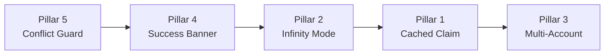

# Senior Review Council — Architectural Evaluation & Blueprint
## Bahonar-Nut (Selfiyar) — Food Hunt (شکار) Optimization

> **Reviewer:** Senior Review Council — Claude Sonnet 4.6  
> **Date:** 2026-11-23  
> **Scope:** 5 Pillars — Network Latency, Infinity Mode, Multi-Account Concurrency,
> Hunt-Success Persistence, Conflict Guard

---

## Executive Summary

The Food Hunt engine (`DefaultSnipeEngine` + `CullinanBasketBuy`) is well-structured and
defensively coded, but it carries **four architectural gaps** that together cap its competitive
capability at around 2–4 seconds of claim latency and prevent concurrent multi-account hunts.
This report provides a concrete blueprint for each of the five requested pillars.

| Pillar | Current State | Target State | Complexity |
|--------|--------------|--------------|------------|
| 1. Zero-overhead claim | 2–4 RTTs per claim | 1 RTT (cached form-state) | Medium |
| 2. Infinity (∞) mode | Floor: 2 s | Floor: 0 (server-pace) | Low |
| 3. Multi-account engine | Single-listener, service-kill bug | Per-account listeners + ref-counted service | High |
| 4. Hunt-success banner | No persistence | `PlainStore` key per account, inline banner | Low |
| 5. Conflict guard | No check | LocalMealStore overlap detection + UI block | Low |

---

## Pillar 1 — Network & WebForms Latency Optimization

### 1.1  Root-Cause Analysis: Why `claim` Discards `fetchBasket`'s Work

**Current flow:**

```
fetchBasket(session, cursor)              ← Poll N
  → _readBasketHtml()
      → (cache hit) POST date-filter      RTT-1
        → response.body → _formState = new state
  → parse listings
  → returns BasketPage                    ← engine sees listings

[engine ranks → match found]

claim(session, listingId)                ← Claim
  → _readBuyPage(session, parts.date)    ← NEW CALL, ignores _formState!
      → GET FoodBasketBuy.aspx           RTT-A  (plain GET, default date)
      → (date mismatch) POST date-filter RTT-B
  → _submitBasketRow(session, html, parts)
      → (optional hall-switch POST)      RTT-C
      → purchase POST                    RTT-D
```

The claim's `_readBuyPage` (line 291–316) **always** starts with a fresh `transport.get`.
It does not consult `_formState`. This means:

1. The state from the most recent `fetchBasket` poll (which already has the right date and a
   fresh viewstate) is thrown away.
2. A `GET` is issued unconditionally, costing one full RTT.
3. If the default date differs from the target, a second `POST` follows (another RTT).
4. Only then can the purchase POST be sent.

**Total latency: 2–4 RTTs at 100–300 ms each = 200 ms – 1200 ms of pure waste.**

The original comment on `_formState` (lines 30–43) explicitly says it was designed to cache
form state *between polls*, but the claim path was written to be safe and self-contained rather
than to exploit that cache.

### 1.2  ASP.NET WebForms Mechanics — Can We Blind-POST?

A "blind" POST — sending a purchase body without first reading the page — would need to invent
its own `__VIEWSTATE`, `__EVENTVALIDATION`, and `__VIEWSTATEGENERATOR`. These fields are:

- **`__VIEWSTATE`**: A base64-encoded, server-signed blob encoding the control tree. It is
  signed with a machine-level `machineKey`. An invented or stale blob causes ASP.NET to either
  return a 500 "Validation of viewstate MAC failed" or to serve a fresh default page (200 OK).
  It **cannot be forged** without the portal's private key.
- **`__EVENTVALIDATION`**: A signed list of the event-argument pairs that are allowed from this
  page. If `drpFood`'s `optionId` was not in the page the server just rendered, the validation
  hash will not contain it and ASP.NET will throw `InvalidOperationException: Invalid postback
  or callback argument`. The portal returns this as a 200 error page.
- **`drpFood` option ids**: These are dynamically generated per hall per render. An option id
  that was valid on poll N is *still valid on the server* unless the session expired — ASP.NET
  does not rotate option ids between requests, only between sessions.

**Conclusion on blind POST:** Sending the purchase POST with the `__VIEWSTATE` and
`__EVENTVALIDATION` from the most recent *successful `fetchBasket` response* for the **same
session** is **safe and expected to work**. The key insight is that these tokens are already
available on `_formState`. A "blind" POST using these tokens is not truly blind — it is a
*cached-state* POST, and it is exactly what `_postDateFilter` already does for polls.

### 1.3  Optimal Zero-Overhead Claim Strategy

**The fix is surgical and low-risk.** It requires:

1. **Extend `_formState` to also cache the last full buy-page HTML** (or the already-parsed
   form body for the claim), tagged with the target date it was filtered to.
2. **In `claim`, check the cache before calling `_readBuyPage`.**

Here is the concrete implementation blueprint:

#### Step A — Enrich `_BasketFormState` with the page body

```dart
class _BasketFormState {
  const _BasketFormState({
    required this.account,
    required this.sessionKey,
    required this.viewState,
    required this.viewStateGenerator,
    required this.eventValidation,
    required this.viewStateEncrypted,
    this.lastPageHtml,          // NEW
    this.lastPageJalaliDate,    // NEW — the date this page is filtered to
  });

  final String? lastPageHtml;
  final String? lastPageJalaliDate;

  // existing fields ...

  /// Whether [html] was fetched for [jalaliDate] and may be used by claim.
  bool htmlIsFor(String jalaliDate) =>
      lastPageHtml != null && lastPageJalaliDate == jalaliDate;
}
```

Update every place that constructs `_BasketFormState.from` to also carry the HTML:

```dart
// In _postDateFilter, after the response passes all checks:
final next = _BasketFormState.from(session, response.body).copyWithPage(
  html: response.body,
  jalaliDate: wanted,
);
_formState = next.isUsable ? next : null;
return response;
```

#### Step B — Fast-path `claim` using the cached page

```dart
Future<ClaimResult> claim(Session session, ListingId listingId) async {
  applySession(session);
  final parts = _parseListingId(listingId);
  if (parts == null) return const ClaimRejected('شناسه آگهی معتبر نیست.');

  try {
    final wantedJalali = CullinanForms.jalaliOf(parts.date);
    final cached = _formState;

    // Fast path: use the HTML the last fetchBasket already delivered.
    // This saves 1–2 RTTs (GET + date-filter POST) and reduces claim
    // latency from 2–4 RTTs to 1 RTT.
    final html = (cached != null &&
            cached.belongsTo(session) &&
            cached.htmlIsFor(wantedJalali))
        ? cached.lastPageHtml!
        : await _readBuyPage(session, parts.date);

    return await _submitBasketRow(session, html, parts);
  } on TransportException catch (e) {
    return ClaimAmbiguous(e.message);
  } finally {
    // A claim changes server-side state; the next poll must re-read.
    _formState = null;
  }
}
```

#### Step C — Invalidation Safety

The `finally` block already nulls `_formState`. The cached HTML becomes stale the moment
`claim` completes (whether it succeeded or failed), so the next `fetchBasket` poll issues
a fresh GET — which is exactly the right behaviour.

**Risk Assessment:** The `__EVENTVALIDATION` in a cached state may become invalid if the
portal rotated the session between the last poll and the claim. The existing
`_submitBasketRow` already handles this correctly: if `_offeredListing` returns null (the
option is gone), the hall-switch POST is attempted, and if that too fails, the claim returns
`ClaimRejected`. No new failure modes are introduced.

**Expected latency reduction:** From 300–1200 ms down to **100–300 ms per claim** (single
purchase POST only).

---

## Pillar 2 — Sub-2-Second Peak Interval with Infinity (∞) Mode

### 2.1  Current State

`HuntBounds.minPeakInterval = Duration(seconds: 2)` is a hard floor. `HuntBounds.clampPeak`
enforces it. The `HuntRate` constructor clamps on construction. The engine's `_intervalFor`
subtracts elapsed time from the interval and sleeps the remainder, but `sleepDuration` is
clamped to `Duration.zero` — not `Duration.zero` as "no sleep", but as "sleep ended, start
the next poll". With `minPeakInterval = Duration(seconds: 2)`, the gap between poll-starts
is at minimum 2 s.

### 2.2  Semantics of Duration.zero in the Poll Loop

Looking at the loop's sleep logic:

```dart
final sleepDuration = remaining.isNegative ? Duration.zero : remaining;
if (sleepDuration > Duration.zero) {
  await Future.any([_sleep(sleepDuration), run.cancelled]);
}
```

If `interval = Duration.zero`, then `remaining` = `0 - elapsed` which is always negative,
so `sleepDuration = Duration.zero`, and the `if` guard skips the sleep entirely. The next
poll fires immediately after the previous one completes. This is precisely the semantics of
"as fast as the server responds" (server-paced, not clock-paced).

This means `Duration.zero` is a **fully safe and correct sentinel** for ∞ mode — no special
casing in the loop is needed.

### 2.3  Implementation Blueprint

#### Step A — `HuntBounds`

```dart
abstract final class HuntBounds {
  /// Special sentinel: poll at server pace (no artificial sleep).
  ///
  /// Represented in the UI as ∞. The engine's sleep guard (`if sleepDuration
  /// > Duration.zero`) already skips the wait when the interval is zero, so
  /// this value needs no special loop handling.
  static const Duration infinityInterval = Duration.zero;

  /// Whether [interval] is the infinity sentinel.
  static bool isInfinity(Duration interval) => interval == Duration.zero;

  static const Duration minPeakInterval = Duration(seconds: 2);
  // ... existing bounds ...

  /// Clamps a peak interval, recognising the infinity sentinel.
  static Duration clampPeak(Duration interval) {
    if (interval == Duration.zero) return Duration.zero; // allow ∞
    if (interval < minPeakInterval) return minPeakInterval;
    if (interval > maxPeakInterval) return maxPeakInterval;
    return interval;
  }
}
```

#### Step B — `HuntRate` and `HuntConfig.projectedRequests`

`projectedRequests` divides by `rate.peakInterval.inSeconds`. Guard against division by zero:

```dart
int projectedRequests() {
  final peak = peakOverlapSeconds;
  final offPeak = windowSeconds - peak;
  final hallMultiplier = hallPriority.length > 1 ? math.min(2, hallPriority.length) : 1;

  final peakReqs = rate.peakInterval == Duration.zero
      ? 0   // ∞ mode: requests are unbounded; display 0 or a special symbol
      : peak / rate.peakInterval.inSeconds;
  final offPeakReqs = rate.offPeakInterval.inSeconds > 0
      ? offPeak / rate.offPeakInterval.inSeconds
      : 0;

  return ((peakReqs + offPeakReqs) * hallMultiplier).ceil();
}
```

#### Step C — `computeBudget`

```dart
// In computeBudget:
final peakInterval = rate.peakInterval.inSeconds;
final requests =
    ((peakInterval > 0 ? peakSecs / peakInterval : 0.0) +  // 0 for ∞
    (offPeakInterval > 0 ? offPeakSecs / offPeakInterval : 0.0)) * hallMultiplier;
```

The budget is then the `defaultRequestBudget` floor (400), which remains the backstop.

#### Step D — UI Slider in `HuntScreen`

The peak-interval slider should:
- Use a custom discrete value scale: `[∞, 2 s, 5 s, 10 s, 20 s, 30 s, 60 s]`
- Render `∞` as the leftmost label (slider minimum)
- When ∞ is selected, display a label such as:
  «سریع‌ترین حالت: بدون وقفه مصنوعی (محدود به سرعت پاسخ سرور)»

```dart
// Example discrete slider mapping
const _peakIntervalOptions = [
  Duration.zero,           // ∞
  Duration(seconds: 2),
  Duration(seconds: 5),
  Duration(seconds: 10),
  Duration(seconds: 20),
  Duration(seconds: 30),
  Duration(seconds: 60),
];

String _intervalLabel(Duration d) =>
    d == Duration.zero ? '∞' : '${d.inSeconds} ث';
```

#### Step E — Safety / Backstop Considerations

| Concern | Mitigation |
|---------|-----------|
| Rate limit / ban | The request budget (400 default) is the hard backstop — ∞ mode exhausts it faster but cannot exceed it |
| Session expiry | Already handled: `LoginRejectedException` triggers re-auth; the session outlives the poll |
| Circuit breaker | Already present: 5 consecutive failures → abort. At server pace, a slow server naturally throttles the hunt |
| Request accounting | `RequestLedger.totalFor` counts actual HTTP requests, not polls — ∞ mode does not break this |

> [!WARNING]
> ∞ mode will exhaust the default 400-request budget in roughly the time the portal takes to
> respond to 400 requests. At 200 ms/response that is ~80 seconds. The UI **must** show the
> budget prominently when ∞ is selected, and the product owner should consider whether
> `defaultRequestBudget` should be raised for ∞-mode hunts (e.g., to 1000+).

---

## Pillar 3 — Concurrent Multi-Account Hunting Engine

### 3.1  Current Bugs

#### Bug A — Single listener overwrites on second account start

```dart
// DefaultSnipeEngine
HuntOutcomeListener _listener;

@override
set listener(HuntOutcomeListener value) => _listener = value;
```

Starting account B's hunt calls `engine.listener = HuntNotifier(accountId: B)`, which
silently replaces account A's notifier. Account A's purchase notification is now delivered
to account B's callback, or to `NoopHuntListener` if B's hunt ends first.

#### Bug B — `HuntState` has single `_huntRunning` and `_huntStatus`

```dart
bool _huntRunning = false;
SnipeRunStatus? _huntStatus;
```

When account A is hunting and the user switches to account B, `setRunning(true)` for B
overwrites A's state. The UI shows B as running even after A's hunt ends, or vice versa.

#### Bug C — `HuntService.stop` calls `_releaseService()` unconditionally

```dart
Future<void> stop(AccountId accountId) async {
  await engine.stop(_ruleId(accountId));
  await _releaseService();   // ← always stops the foreground service!
  ...
}
```

If account A and B are hunting concurrently and the user stops A, `_releaseService()` calls
`bridge.stopHuntService()`, which sends `ACTION_STOP` to the Android service. The service's
`onStartCommand` stops itself with `stopSelf()`, killing the service and therefore also B's
hunt.

#### Bug D — `_HomeShellState._huntStatusSub` is a single subscription

```dart
StreamSubscription<SnipeRunStatus>? _huntStatusSub;
```

Subscribing to B's status replaces A's subscription, losing A's live updates.

### 3.2  Multi-Account Architecture Blueprint

#### Layer 1 — `DefaultSnipeEngine`: per-rule listener map

Replace the single `_listener` with a `Map<String, HuntOutcomeListener>`:

```dart
// BEFORE
HuntOutcomeListener _listener;
set listener(HuntOutcomeListener value) => _listener = value;

// AFTER
final Map<String, HuntOutcomeListener> _listeners = {};

void setListener(String ruleId, HuntOutcomeListener value) {
  _listeners[ruleId] = value;
}

HuntOutcomeListener _listenerFor(String ruleId) =>
    _listeners[ruleId] ?? const NoopHuntListener();
```

Update `_claim` and all `_listener.onClaimed/onEnded` call sites to use `_listenerFor(rule.id)`.
Remove the singleton `set listener` from `SnipeEngine`'s abstract interface, or keep it as
a compatibility shim that sets the default for rules with no explicit listener.

```dart
// In _claim:
final listener = _listenerFor(rule.id);
await listener.onClaimed(ruleId: rule.id, listing: listing, reservation: reservation);

// In _runLoop finally:
_listeners.remove(rule.id);   // clean up with the run
```

#### Layer 2 — `HuntService`: ref-counted service lifetime

```dart
class HuntService {
  int _activeHunts = 0;

  Future<void> start({required AccountId accountId, required HuntConfig config}) async {
    if (!config.enabled) return;
    _activeHunts++;
    await bridge.startHuntService(payload: accountId);
    final rule = config.toRule(id: _ruleId(accountId), account: accountId);
    engine.setListener(rule.id, HuntNotifier(
      service: this, accountId: accountId, configStore: configStore,
    ));
    await engine.start(rule, hunt: config);
  }

  Future<void> stop(AccountId accountId) async {
    await engine.stop(_ruleId(accountId));
    _decrementAndMaybeRelease();
    // ... alarm cancel + config disable
  }

  Future<void> reportOutcome({...}) async {
    await bridge.postNotification(...);
    _decrementAndMaybeRelease();
    // ...
  }

  void _decrementAndMaybeRelease() {
    _activeHunts = (_activeHunts - 1).clamp(0, 999);
    if (_activeHunts == 0) {
      unawaited(_releaseService());
    }
  }
}
```

> [!IMPORTANT]
> `_activeHunts` must be decremented in `reportOutcome` as well as `stop`, because a hunt
> that ends naturally (window closed, budget spent) goes through `reportOutcome`, not `stop`.
> Over-releasing (calling `stopHuntService` when other hunts are active) is the core bug.

#### Layer 3 — `HuntState`: per-account status maps

```dart
class HuntState extends ChangeNotifier {
  // BEFORE: single fields
  // bool _huntRunning = false;
  // SnipeRunStatus? _huntStatus;

  // AFTER: per-account maps
  final Map<AccountId, bool> _huntRunning = {};
  final Map<AccountId, SnipeRunStatus?> _huntStatus = {};

  bool huntRunningFor(AccountId accountId) => _huntRunning[accountId] ?? false;
  SnipeRunStatus? huntStatusFor(AccountId accountId) => _huntStatus[accountId];

  // Keep convenience getters for the active account for backward compat:
  bool get huntRunning => huntRunningFor(_activeHuntAccount ?? '');
  SnipeRunStatus? get huntStatus => huntStatusFor(_activeHuntAccount ?? '');

  void setHuntRunning(AccountId accountId, bool value) {
    _huntRunning[accountId] = value;
    if (!value) _huntStatus.remove(accountId);
    notifyListeners();
  }

  void setHuntStatus(AccountId accountId, SnipeRunStatus? status) {
    _huntStatus[accountId] = status;
    notifyListeners();
  }
}
```

#### Layer 4 — `_HomeShellState`: per-account subscription map

```dart
// BEFORE
StreamSubscription<SnipeRunStatus>? _huntStatusSub;

// AFTER
final Map<AccountId, StreamSubscription<SnipeRunStatus>> _huntStatusSubs = {};

void _subscribeHuntStatus(AccountId accountId) {
  _huntStatusSubs[accountId]?.cancel();
  _huntStatusSubs[accountId] = widget.services.engine
      .watch('hunt-$accountId')
      .listen((status) {
    if (mounted) widget.state.setHuntStatus(accountId, status);
  });
}

@override
void dispose() {
  for (final sub in _huntStatusSubs.values) {
    unawaited(sub.cancel());
  }
  _huntStatusSubs.clear();
  // ...
}
```

#### Layer 5 — Android `HuntService.kt`: no changes needed

The Kotlin service is a dumb process-keeper. The `stop(context)` call it handles is what
`PlatformBridge.stopHuntService()` sends. With the ref-counted Dart side, `stopHuntService`
is only called when truly no hunts remain — so the Kotlin service sees one `START` and one
`STOP` per session, regardless of how many accounts hunted.

> [!NOTE]
> If in future the product wants **per-account** foreground notifications (each showing its
> own account's status), the service should be extended to hold a map of active payloads and
> update its notification text. For now, the single notification with a generic "monitoring
> basket" message is acceptable.

---

## Pillar 4 — Successful Hunt Persistence, Header Banner, and Deep Link Navigation

### 4.1  Persistence Design

The last successful hunt per account should be persisted in `PlainStore` under a key-per-account
pattern. `HuntConfigStore` is already per-account; the success record is closely related but
read on different occasions (every time the account is selected in the Hunt screen), so a
separate key family is cleaner.

**Proposed data model:**

```dart
/// The result of the last successful hunt for one account.
class LastHuntSuccess {
  const LastHuntSuccess({
    required this.accountId,
    required this.dishName,
    required this.hallName,
    required this.priceRial,
    required this.date,
    required this.slot,
    required this.claimedAt,
  });

  final AccountId accountId;
  final String dishName;
  final String hallName;
  final int priceRial;
  final DateTime date;
  final MealSlot slot;
  final DateTime claimedAt;

  static const String _storeKeyPrefix = 'hunt_success_';
  static String storeKey(AccountId accountId) => '$_storeKeyPrefix$accountId';

  Map<String, dynamic> toJson() => {
    'dishName': dishName,
    'hallName': hallName,
    'priceRial': priceRial,
    'date': date.toIso8601String(),
    'slot': slot.name,
    'claimedAt': claimedAt.toIso8601String(),
  };

  static LastHuntSuccess? fromJson(AccountId accountId, Map<String, dynamic> json) {
    // ... parse fields with null-safety
  }
}
```

**Where to persist:** In `HuntNotifier.onClaimed`, after the config is disabled, persist to
`PlainStore`:

```dart
await plainStore.writeString(
  LastHuntSuccess.storeKey(accountId),
  jsonEncode(LastHuntSuccess(
    accountId: accountId,
    dishName: listing.option.name,
    hallName: listing.hall.name,
    priceRial: listing.option.priceRial,
    date: listing.date,
    slot: listing.slot,
    claimedAt: DateTime.now().toUtc(),
  ).toJson()),
);
```

**When to load:** In `HuntState.loadConfigs()` / `reloadConfig()`. Add a parallel map:

```dart
final Map<AccountId, LastHuntSuccess> _lastSuccesses = {};

LastHuntSuccess? lastSuccessFor(AccountId accountId) => _lastSuccesses[accountId];

Future<void> _loadSuccess(AccountId accountId) async {
  final raw = await plainStore?.readString(LastHuntSuccess.storeKey(accountId));
  if (raw == null || raw.isEmpty) return;
  final parsed = LastHuntSuccess.fromJson(accountId, jsonDecode(raw));
  if (parsed != null) _lastSuccesses[accountId] = parsed;
}
```

### 4.2  Hunt Screen Banner

Add a `lastSuccess` parameter to `HuntScreen`:

```dart
final LastHuntSuccess? lastSuccess;
```

Render the banner at the **top of the hunt screen**, above the wizard steps, only when:
- The account has a `lastSuccess` record, **and**
- No hunt is currently running

```dart
// In HuntScreen build():
if (widget.lastSuccess != null && !widget.isRunning)
  _HuntSuccessBanner(success: widget.lastSuccess!),
```

```dart
class _HuntSuccessBanner extends StatelessWidget {
  const _HuntSuccessBanner({required this.success});
  final LastHuntSuccess success;

  @override
  Widget build(BuildContext context) {
    final jDate = toJalali(success.date);
    final toman = formatTomanPersian(success.priceRial);
    return Card(
      color: Theme.of(context).colorScheme.secondaryContainer,
      margin: const EdgeInsets.symmetric(horizontal: 16, vertical: 8),
      child: ListTile(
        leading: const Icon(Icons.check_circle_outline, color: Colors.green),
        title: Text('آخرین شکار موفق: ${success.dishName}'),
        subtitle: Text(
          '${success.hallName} · $toman · ${jDate.dayMonth}',
          style: Theme.of(context).textTheme.bodySmall,
        ),
      ),
    );
  }
}
```

### 4.3  Deep Link Navigation

The existing deep-link handler in `_HomeShellState._handleDeepLink` already parses
`nut://hunt-success?...` and shows `HuntSuccessDialog`. To navigate directly to the Hunt
screen and show the banner (without a modal dialog), extend the handler:

```dart
// Option A (current): show modal dialog on notification tap → keep as is
// Option B (new): navigate to Hunt tab showing the banner

if (uri.scheme == 'nut' && uri.host == 'hunt-success') {
  final account = uri.queryParameters['account'];
  if (account != null) widget.state.selectHuntAccount(account);
  setState(() => _index = 4); // Hunt tab index
  // The banner is now visible because lastSuccess is loaded for this account
  return true;
}
```

The choice between A (modal) and B (inline banner) is a product decision. The Council
recommends **B** for the notification tap (banner is persistent, dismissable by the student
at their own pace) and keeping **A** for in-app success (immediate gratification with the
dialog).

---

## Pillar 5 — Conflict Guard (Preventing Hunt When Meal Already Held)

### 5.1  Where to Check

`ReservationsState.mealsFor(accountId)` returns `List<StoredMeal>` from `LocalMealStore`.
`StoredMeal` carries `date`, `slot`, and implicitly whether the meal is active (not consumed,
not cancelled). The check is a scan of this list for the hunt's `(targetDate, targetSlot)`.

> [!IMPORTANT]
> The local meal mirror may be stale. The conflict guard blocks the **Start button** (a UI
> affordance, not a safety check), but the engine's pre-flight (`PreflightChecker.check`)
> already reads live reservations from the portal and would catch a held meal there too. The
> local check is a convenience that saves the student from starting a hunt that the pre-flight
> would immediately abort.

### 5.2  Conflict Detection Logic

```dart
/// Returns true when [accountId] holds a meal for [(targetDate, targetSlot)].
///
/// Checks the local mirror only. A null [targetDate] means the hunt targets
/// "today" or "the next available", which cannot be conflict-checked without
/// a live read — so the method returns false (no block) in that case.
bool holdsMealFor(
  AccountId accountId, {
  required DateTime? targetDate,
  required MealSlot targetSlot,
}) {
  if (targetDate == null) return false;
  final meals = mealStore.forAccount(accountId);
  for (final meal in meals) {
    if (meal.date.year == targetDate.year &&
        meal.date.month == targetDate.month &&
        meal.date.day == targetDate.day &&
        meal.slot == targetSlot) {
      return true; // A meal for this (date, slot) is already held
    }
  }
  return false;
}
```

This logic belongs in `ReservationsState` (it already owns `mealStore`) or as a free
function in a utility module.

### 5.3  Surface `enableRefusal` in `HuntState`

The `HuntState` already has `_huntEnableRefusal` / `setEnableRefusal(String? refusal)`.
Populate it when the account is selected or the config changes:

```dart
// In _HomeShellState, after selectHuntAccount or saveConfig:
void _checkHuntConflict(AccountId accountId, HuntConfig config) {
  final conflictDate = config.targetDate;
  final conflictSlot = config.targetSlot;
  final held = widget.state.holdsMealFor(
    accountId,
    targetDate: conflictDate,
    targetSlot: conflictSlot,
  );
  if (held) {
    widget.state.setEnableRefusal(
      'برای این (تاریخ، وعده) قبلاً رزرو دارید. شکار غیرفعال است.',
    );
  } else {
    widget.state.setEnableRefusal(null);
  }
}
```

This is called:
1. When `selectHuntAccount` is called.
2. When the user changes `targetDate` or `targetSlot` in the wizard.
3. When `reloadConfigs` / `mealsChanged` runs (to pick up newly arrived reservations).

### 5.4  UI: Disable Start Button and Show Warning

`HuntScreen` already accepts `enableRefusal`. In the existing button logic:

```dart
// Start button is already disabled when enableRefusal is non-null.
// The existing chip/banner for enableRefusal needs a specific conflict icon.
if (widget.enableRefusal != null)
  _InfoChip(
    icon: Icons.warning_amber_rounded,
    color: Theme.of(context).colorScheme.error,
    text: widget.enableRefusal!,
  ),
```

No new widget is needed — just ensure the conflict message is Persian, specific, and
distinguishable from an unrelated "enable refusal" (e.g., window closed):

```dart
// Good message:
'برای وعده ${config.targetSlot.persianName} در تاریخ ${jDate.dayMonth} '
'قبلاً رزرو یا خرید دارید. دو وعده هم‌زمان در سامانه ثبت نمی‌شود.'
```

> [!TIP]
> Also add `holdsMealFor` as an input parameter to the `PreflightChecker`, so the conflict
> check is enforced by the engine itself — not just by the UI. The pre-flight already reads
> `holdings` from the portal (live), so this would be an additional local short-circuit.

---

## Cross-Cutting Concerns

### Testing

| Change | Recommended Test |
|--------|-----------------|
| Cached-state claim (Pillar 1) | Unit: `CullinanBasketBuy` with a fake transport that records calls; assert GET is not called when cache is fresh |
| ∞ mode poll loop (Pillar 2) | Unit: inject `sleep = (d) => Future.value()` and a fake clock; assert the loop fires N times without any sleep calls |
| Multi-account listener map (Pillar 3) | Unit: start two rules, trigger `onClaimed` for each, assert each account's listener got the right ruleId |
| Ref-counted service (Pillar 3) | Unit: `HuntService` with a fake bridge; start A and B, stop A, assert `stopHuntService` not called; stop B, assert it is called |
| Conflict guard (Pillar 5) | Unit: `holdsMealFor` with a seeded `LocalMealStore`; assert true when date+slot match, false otherwise |

### Sequencing Recommendation



Pillars 5 and 4 are purely additive (no refactoring risk). Pillar 2 is a small bounds change.
Pillar 1 is a targeted adapter change. Pillar 3 is the most disruptive and should be last,
after the others are verified in production.

---

## Appendix: File References

| File | Relevance |
|------|-----------|
| [`cullinan_basket_buy.dart`](../../lib/adapter/cullinan/cullinan_basket_buy.dart) | Pillar 1: `_formState`, `claim`, `_readBuyPage` |
| [`hunt_config.dart`](../../lib/core/hunt/hunt_config.dart) | Pillar 2: `HuntBounds`, `HuntRate`, `clampPeak` |
| [`snipe_engine.dart`](../../lib/core/hunt/snipe_engine.dart) | Pillars 2 & 3: `_intervalFor`, `_listener`, `_runs` |
| [`hunt_service.dart`](../../lib/platform/hunt_service.dart) | Pillar 3: `stop`, `reportOutcome`, `_releaseService` |
| [`hunt_state.dart`](../../lib/ui/state/hunt_state.dart) | Pillars 3 & 4 & 5: `_huntRunning`, `_huntStatus`, `_huntEnableRefusal` |
| [`home_shell.dart`](../../lib/ui/shell/home_shell.dart) | Pillar 3: `_huntStatusSub`; Pillar 5: conflict check wiring |
| [`HuntService.kt`](../../android/app/src/main/kotlin/ir/ac/uk/bahonar_nut/HuntService.kt) | Pillar 3: foreground service lifecycle |
| [`reservations_state.dart`](../../lib/ui/state/reservations_state.dart) | Pillar 5: `mealsFor`, `LocalMealStore` |
| [`hunt_screen.dart`](../../lib/ui/features/hunt/hunt_screen.dart) | Pillars 2, 4, 5: slider, banner, enable-refusal |
| [`snipe_claimer.dart`](../../lib/core/hunt/snipe_claimer.dart) | Pillar 1: claim execution path |
